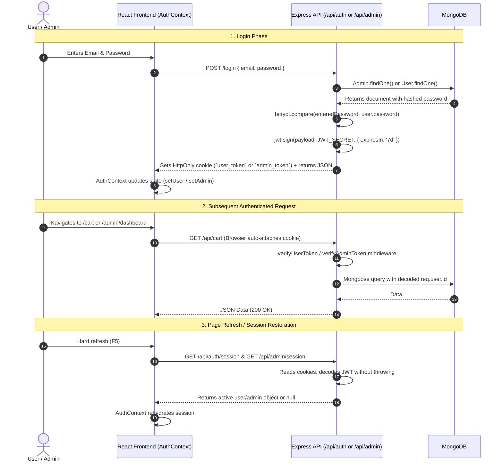

# TechZone — Authentication & Session Architecture

This document details the dual-role authentication architecture, token lifecycle, password encryption, and session persistence across TechZone.

---

## 👥 Dual-Role Security Architecture

TechZone separates customer and administrative access into distinct database models, JWT claims, and HttpOnly cookies.



---

## 🛡️ Token Payload & Cookie Configuration

### 1. Customer Token (`user_token`)
- **Cookie Name**: `user_token`
- **Signing Key**: `process.env.JWT_SECRET`
- **Expiration**: 7 days (`expiresIn: '7d'`)
- **Payload Structure**:
  ```json
  {
    "id": "660c2b1e4f9b8c0012345678",
    "email": "customer@example.com",
    "name": "Alex Mercer",
    "iat": 1718900000,
    "exp": 1719504800
  }
  ```
- **Cookie Flags**:
  - `httpOnly: true` (Prevents client-side JavaScript access / XSS protection)
  - `sameSite: 'lax'` (Guards against CSRF while enabling standard top-level navigations)
  - `secure: process.env.NODE_ENV === 'production'` (Transmitted solely over HTTPS in production)
  - `maxAge: 7 * 24 * 60 * 60 * 1000` (7 days in milliseconds)

---

### 2. Admin Token (`admin_token`)
- **Cookie Name**: `admin_token`
- **Signing Key**: `process.env.JWT_SECRET`
- **Payload Structure**:
  ```json
  {
    "id": "660c1a9e4f9b8c0099999999",
    "email": "admin@techzone.com",
    "name": "System Administrator",
    "isAdmin": true,
    "iat": 1718900000,
    "exp": 1719504800
  }
  ```
- **Claim Enforcement**: The `verifyAdminToken` middleware specifically asserts that `decoded.isAdmin === true`. Ordinary customer tokens attempting to access admin routes are rejected with `403 Forbidden`.

---

## 🔑 Fallback Authorization Header Support

Both `verifyUserToken` and `verifyAdminToken` support standard `Bearer` tokens in the `Authorization` HTTP header for API clients (Postman, mobile apps):

```javascript
let token = req.cookies.user_token;

if (!token && req.headers.authorization && req.headers.authorization.startsWith('Bearer ')) {
    token = req.headers.authorization.split(' ')[1];
}
```

---

## 🔐 Password Hashing & Salting Flow

1. Plaintext passwords submitted via `register` or `admin/login` are never stored.
2. In `models/User.js` and `models/Admin.js`:
   ```javascript
   schema.pre('save', async function(next) {
       if (!this.isModified('password')) return next();
       const salt = await bcrypt.genSalt(10);
       this.password = await bcrypt.hash(this.password, salt);
   });
   ```
3. Passwords are verified via instance method:
   ```javascript
   schema.methods.matchPassword = async function(enteredPassword) {
       return await bcrypt.compare(enteredPassword, this.password);
   };
   ```

---

## 🚪 Session Restoration & Logout Flow

- **Session Restoration (`AuthContext.jsx`)**:
  When the application initializes, `checkSession()` fires two non-throwing requests:
  - `GET /api/auth/session` -> populates `user` state and triggers `fetchCartCount()`.
  - `GET /api/admin/session` -> populates `admin` state.
  If a token is absent or invalid, the backend returns `null` or 401, which the Axios interceptor suppresses cleanly.

- **Logout**:
  - `POST /api/auth/logout`: Clears `user_token` cookie and sets `user = null` in context.
  - `POST /api/admin/logout`: Clears `admin_token` cookie and sets `admin = null` in context.
