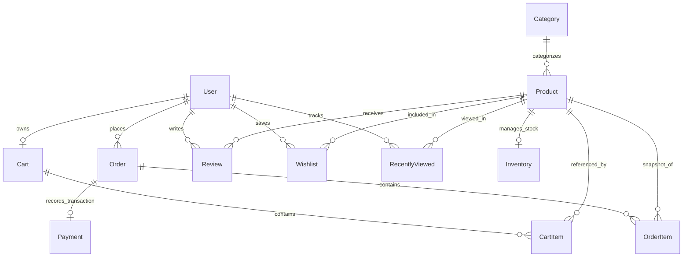

# TechZone — Database Architecture & Schema Analysis

## 🗄️ Database Engine Overview
- **Database**: MongoDB (NoSQL Document Store)
- **Object Data Modeling (ODM)**: Mongoose (v9.5.0)
- **Connection Configuration**: Managed in `backend/config/db.js` using `mongoose.connect(process.env.MONGO_URI)`.
- **Default Database URI**: `mongodb://localhost:27017/dryfruit_hub_db` (or `techzone_db`)

---

## 📊 Entity Relationship Diagram

---

## 📋 Comprehensive Model Specifications

### 1. `Admin` Collection (`models/Admin.js`)
Stores privileged administrator credentials for accessing the management dashboard.
| Field | Type | Attributes | Description |
|---|---|---|---|
| `_id` | ObjectId | Primary Key | Auto-generated unique identifier |
| `name` | String | Required | Full name of administrator |
| `email` | String | Required, Unique, Trim, Lowercase | Admin login identifier |
| `password` | String | Required | Bcrypt-hashed password string |
| `createdAt` | Date | Timestamp | Creation timestamp |
| `updatedAt` | Date | Timestamp | Last modification timestamp |

**Instance Methods & Hooks**:
- `adminSchema.methods.matchPassword(enteredPassword)`: Compares plain text password against hashed password via `bcrypt.compare`.
- `adminSchema.pre('save')`: Hashes password using a 10-round salt before saving if the password field is modified.

---

### 2. `User` Collection (`models/User.js`)
Stores customer accounts, authentication profiles, and contact details.
| Field | Type | Attributes | Description |
|---|---|---|---|
| `_id` | ObjectId | Primary Key | Auto-generated unique identifier |
| `name` | String | Required | Customer display name |
| `email` | String | Required, Unique, Trim, Lowercase | Unique customer login email |
| `password` | String | Required | Bcrypt-hashed password string |
| `phone` | String | Optional | Contact phone number |
| `profile_image` | String | Default: `'/uploads/default-avatar.png'` | Profile picture path |
| `createdAt` | Date | Timestamp | Account creation timestamp |
| `updatedAt` | Date | Timestamp | Account modification timestamp |

---

### 3. `Category` Collection (`models/Category.js`)
Defines the product catalog hierarchy.
| Field | Type | Attributes | Description |
|---|---|---|---|
| `_id` | ObjectId | Primary Key | Auto-generated unique identifier |
| `name` | String | Required | Category name (e.g., Mobiles, Laptops, Audio) |
| `description` | String | Optional | Category overview text |
| `image_url` | String | Optional | Category thumbnail image path or URL |
| `createdAt` | Date | Timestamp | Creation timestamp |
| `updatedAt` | Date | Timestamp | Last update timestamp |

---

### 4. `Product` Collection (`models/Product.js`)
Primary inventory entity representing electronics merchandise and technical specifications.
| Field | Type | Attributes | Description |
|---|---|---|---|
| `_id` | ObjectId | Primary Key | Auto-generated unique identifier |
| `category` | ObjectId (Ref: `Category`) | Required | Foreign reference to parent category |
| `name` | String | Required | Product marketing title |
| `description` | String | Optional | Detailed overview of product |
| `price` | Number | Required, Default: `0` | Unit selling price in INR (₹) |
| `stock_quantity` | Number | Required, Default: `0` | Primary stock count indicator |
| `weight` | String | Optional | Variant or capacity spec (e.g., '128GB', '256GB', 'Standard') |
| `image_url` | String | Optional | Primary showcase image path |
| `images` | [String] | Array | Supplementary gallery image paths |
| `is_featured` | Boolean | Default: `false` | Highlighted on home page banners |
| `health_benefits` | String | Optional | Hardware specs (Processor, Camera, Display) |
| `nutrition_info` | String | Optional | Technical details (Battery life, Dimensions, Connectivity) |
| `recommended_intake`| String | Optional | Operating system, software support, charging standard |
| `ai_context_notes` | String | Optional | Domain knowledge notes injected into AI system prompts |
| `createdAt` | Date | Timestamp | Creation timestamp |
| `updatedAt` | Date | Timestamp | Last modification timestamp |

---

### 5. `Inventory` Collection (`models/Inventory.js`)
Enforces real-time stock control and reservation logic for concurrency safety.
| Field | Type | Attributes | Description |
|---|---|---|---|
| `_id` | ObjectId | Primary Key | Auto-generated unique identifier |
| `product` | ObjectId (Ref: `Product`) | Required, Unique | 1:1 foreign reference to target product |
| `available_stock` | Number | Default: `0` | Real-time stock available for order placement |
| `reserved_stock` | Number | Default: `0` | Stock temporarily locked in pending payment carts |
| `createdAt` | Date | Timestamp | Creation timestamp |
| `updatedAt` | Date | Timestamp | Modification timestamp |

---

### 6. `Cart` Collection (`models/Cart.js`)
Maintains persistent shopping carts per authenticated user.
| Field | Type | Attributes | Description |
|---|---|---|---|
| `_id` | ObjectId | Primary Key | Auto-generated unique identifier |
| `user` | ObjectId (Ref: `User`) | Required, Unique | 1:1 owner reference |
| `items` | Array of Subdocuments | Default: `[]` | List of items currently in cart |
| `items.product`| ObjectId (Ref: `Product`) | Required | Target product reference |
| `items.quantity`| Number | Required, Min: 1 | Quantity requested |
| `createdAt` | Date | Timestamp | Creation timestamp |
| `updatedAt` | Date | Timestamp | Modification timestamp |

---

### 7. `Order` Collection (`models/Order.js`)
Stores completed sales contracts, delivery addresses, financial records, and fulfillment states.
| Field | Type | Attributes | Description |
|---|---|---|---|
| `_id` | ObjectId | Primary Key | Auto-generated unique identifier |
| `user` | ObjectId (Ref: `User`) | Required | Customer who placed order |
| `order_number` | String | Required, Unique | Human-readable tracking number (e.g., `RYZ-171890-4821`) |
| `full_name` | String | Required | Recipient full name |
| `email` | String | Required | Notification & invoice email |
| `phone` | String | Required | Delivery contact number |
| `address_line1`| String | Required | Street address, building number |
| `address_line2`| String | Optional | Apartment, suite, floor |
| `city` | String | Required | Destination city |
| `state` | String | Required | Destination state / province |
| `pincode` | String | Required | Postal / PIN code |
| `landmark` | String | Optional | Nearby reference point |
| `total_amount` | Number | Required | Final paid total in INR (Subtotal + Tax + Shipping) |
| `payment_status`| String | Enum: `['Pending', 'Paid', 'Failed']` | Payment lifecycle stage |
| `order_status` | String | Enum: `['Pending', 'Processing', 'Shipped', 'Delivered', 'Cancelled']` | Order fulfillment stage |
| `razorpay_order_id` | String | Optional | Razorpay order ID |
| `razorpay_payment_id` | String | Optional | Razorpay transaction payment ID |
| `items` | Array of Subdocs | Required | Immutable snapshot of purchased items |
| `items.product`| ObjectId (Ref: `Product`) | Required | Product reference |
| `items.quantity`| Number | Required | Purchased quantity |
| `items.unit_price`| Number | Required | Historical unit price at purchase time |
| `items.subtotal`| Number | Required | Item total (`quantity * unit_price`) |
| `createdAt` | Date | Timestamp | Order placement timestamp |
| `updatedAt` | Date | Timestamp | Order update timestamp |

---

### 8. `Payment` Collection (`models/Payment.js`)
Payment audit ledger recording transaction attempts and Razorpay credentials.
| Field | Type | Attributes | Description |
|---|---|---|---|
| `_id` | ObjectId | Primary Key | Auto-generated unique identifier |
| `order` | ObjectId (Ref: `Order`) | Required | Reference to the associated Order |
| `razorpay_order_id` | String | Required | Razorpay order reference ID |
| `razorpay_payment_id` | String | Optional | Razorpay payment confirmation ID |
| `payment_status` | String | Enum: `['Pending', 'Paid', 'Failed']` | Transaction outcome |
| `amount` | Number | Required | Paid amount in INR |
| `createdAt` | Date | Timestamp | Creation timestamp |

---

### 9. `Review` Collection (`models/Review.js`)
Stores customer reviews and star ratings. Can only be created by customers who have purchased the item.
| Field | Type | Attributes | Description |
|---|---|---|---|
| `_id` | ObjectId | Primary Key | Auto-generated unique identifier |
| `user` | ObjectId (Ref: `User`) | Required | Reviewer reference |
| `product` | ObjectId (Ref: `Product`) | Required | Reviewed product reference |
| `rating` | Number | Required, Min: 1, Max: 5 | Star rating |
| `review_text` | String | Required | Customer textual review |
| `createdAt` | Date | Timestamp | Submission timestamp |
| `updatedAt` | Date | Timestamp | Edit timestamp |

---

### 10. `Wishlist` Collection (`models/Wishlist.js`)
Customer bookmarked products for future acquisition.
| Field | Type | Attributes | Description |
|---|---|---|---|
| `_id` | ObjectId | Primary Key | Auto-generated unique identifier |
| `user` | ObjectId (Ref: `User`) | Required | Customer owner reference |
| `product` | ObjectId (Ref: `Product`) | Required | Saved product reference |
| `createdAt` | Date | Timestamp | Saved timestamp |

---

### 11. `RecentlyViewed` Collection (`models/RecentlyViewed.js`)
Tracks user product browsing activity for personalized recommendations.
| Field | Type | Attributes | Description |
|---|---|---|---|
| `_id` | ObjectId | Primary Key | Auto-generated unique identifier |
| `user` | ObjectId (Ref: `User`) | Required | User reference |
| `product` | ObjectId (Ref: `Product`) | Required | Viewed product reference |
| `viewedAt` | Date | Default: `Date.now` | Last timestamp viewed |

---

## ⚡ Indexing & Performance Strategy

1. **Unique Key Constraints**:
   - `User.email` — Unique index prevents duplicate customer accounts.
   - `Admin.email` — Unique index enforces unique admin accounts.
   - `Order.order_number` — Unique index guarantees order tracking collision-resistance.
   - `Inventory.product` — Unique 1:1 foreign reference.
2. **Compound & Query Indexes**:
   - `Review`: `{ user: 1, product: 1 }` allows instant verification of whether a customer already reviewed an item.
   - `Order`: `{ user: 1, createdAt: -1 }` accelerates customer order history queries.
   - `Product`: `{ category: 1, price: 1 }` enables fast category browsing with price filtering.
