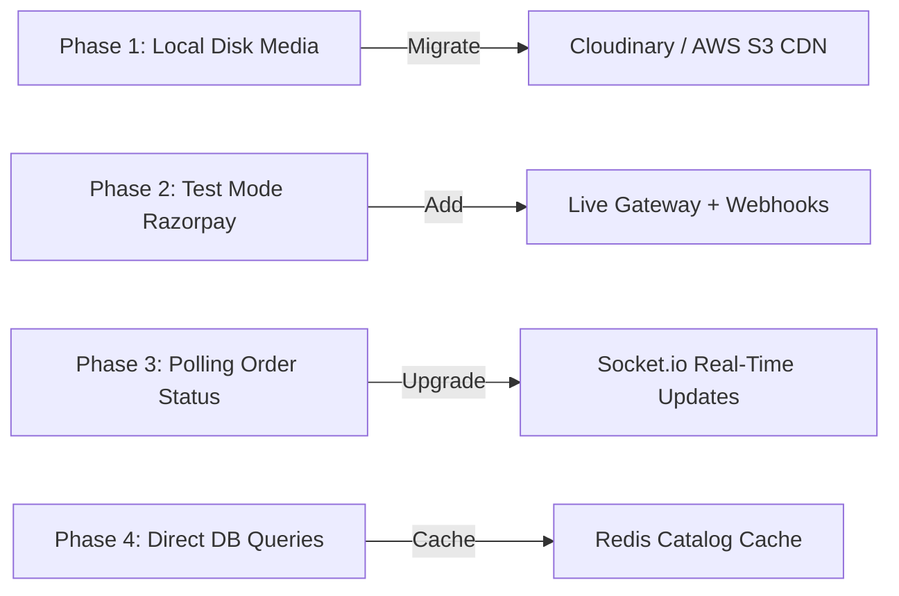

# TechZone — SQL to NoSQL Migration Insights & Future Roadmap

This document outlines the architectural transformation from a relational SQL database to a scalable MongoDB document store, along with the enterprise roadmap for production scaling.

---

## 🔄 SQL to NoSQL Transformation Overview

The TechZone platform previously operated on a relational SQL model (`techzone_db.sql`). It was re-architected to a high-throughput **MongoDB (NoSQL)** document store to optimize read-heavy e-commerce operations, support flexible electronic hardware specifications, and eliminate complex multi-table JOIN bottlenecks.

### Structural Mapping Comparison

| Relational SQL Entity (Previous) | MongoDB Mongoose Model (Current) | Modeling Paradigm & Benefit |
|---|---|---|
| `users` table | `models/User.js` | Direct document storage with bcrypt pre-save hashing |
| `admins` table | `models/Admin.js` | Dedicated administrative collection preventing role overlap |
| `categories` table | `models/Category.js` | Referenced by products |
| `products` & `product_images` tables | `models/Product.js` | Embedded `images: [String]` array; eliminated `product_images` JOIN |
| `inventory` table | `models/Inventory.js` | Isolated collection for high-frequency atomic stock updates |
| `carts` & `cart_items` tables | `models/Cart.js` | Embedded `items` subdocument array; 1 atomic read/write per cart |
| `orders` & `order_items` tables | `models/Order.js` | Embedded `items` snapshot; permanently freezes historical unit prices |
| `payments` table | `models/Payment.js` | 1:1 audit ledger linked by `order` ObjectId |
| `reviews` table | `models/Review.js` | Document referencing `user` and `product` with verified purchase guard |
| `wishlists` table | `models/Wishlist.js` | Lightweight reference document |
| `recently_viewed` table | `models/RecentlyViewed.js` | Lightweight reference document with automatic timestamp indexing |

---

## 💡 Key Architectural Challenges Solved

### 1. Eliminating Foreign Key Constraints with Document Embedding
- In SQL, retrieving an order required querying `orders`, joining `order_items`, and joining `products`.
- In MongoDB, `Order.items` stores an immutable snapshot of `name`, `unit_price`, `quantity`, and `subtotal` directly inside the order document.
- **Benefit**: If an administrator edits a product's name or price in the future, past order invoices and sales analytics remain 100% accurate.

### 2. Concurrency Safety Without Table Locks
- Relational databases rely on row locks (`SELECT ... FOR UPDATE`) during order placement.
- In MongoDB, concurrency is handled cleanly using document-level atomicity with `$inc` and `$gte`:
  ```javascript
  await Inventory.findOneAndUpdate(
      { product: id, available_stock: { $gte: quantity } },
      { $inc: { available_stock: -quantity } }
  );
  ```

### 3. Automated Seeding Pipeline (`backend/scripts/seedElectronicsData.js`)
- A standalone automated script connects to MongoDB, cleans collections, populates 5 modern categories (Mobiles, Laptops, Headphones, Smart Watches, Accessories), inserts flagship products, and syncs initial `Inventory` records.

---

## 🚀 Production Scaling Roadmap



### 1. Cloud Media Storage (Cloudinary / AWS S3)
- **Current State**: Media files are written to local disk in `backend/uploads/`.
- **Roadmap**: Integrate `multer-storage-cloudinary` to stream uploaded product photos and avatars directly to a global CDN, enabling multi-instance horizontal scaling without disk volume replication.

### 2. Live Payment Webhook Architecture
- **Current State**: Test Mode uses client-triggered verification (`POST /api/payment/test-success`).
- **Roadmap**: Implement a dedicated asynchronous Razorpay Webhook endpoint (`/api/payment/webhook`) to handle payment confirmation even if the customer's browser closes before the redirect completes.

### 3. Real-Time Order Tracking (WebSockets / Socket.io)
- **Roadmap**: Establish a bidirectional WebSocket connection between the admin dashboard and customer order view to push instant notifications when an order moves from `Processing` to `Shipped` or `Delivered`.

### 4. Redis Catalog Caching
- **Roadmap**: Implement a Redis cache layer for `GET /api/products` and `GET /api/products/categories` with automatic cache invalidation upon admin product CRUD.
