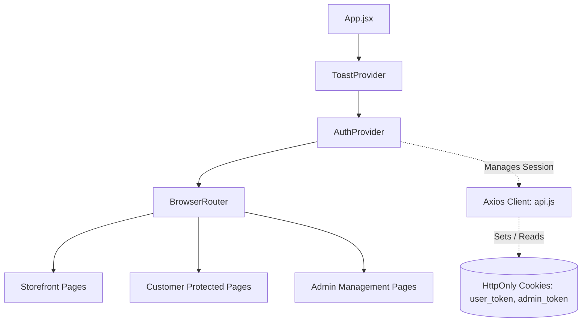

# TechZone — State Management & Session Lifecycle

This document describes client-side state distribution, context providers, Axios interceptors, and session lifecycle handling.

---

## 🌐 State Architecture Overview

TechZone employs React Context for cross-cutting global state (`AuthContext` and `ToastContext`), coupled with localized state via standard React hooks (`useState`, `useReducer`) for page-specific workflows.



---

## 🔐 1. Authentication State (`context/AuthContext.jsx`)

The `AuthContext` provides global session state, role validation, and shopping cart counter synchronization:

### Exported Values & Handlers
| State / Method | Type | Description |
|---|---|---|
| `user` | Object \| null | Authenticated customer object (`{ id, name, email, phone, profile_image }`) |
| `admin` | Object \| null | Authenticated administrator object (`{ id, name, email, isAdmin: true }`) |
| `cartCount` | Number | Real-time count of unique items currently held in the user's cart |
| `loading` | Boolean | True while initial session rehydration is resolving |
| `loginUser(email, pass)` | Async Function | Dispatches credentials to `/api/auth/login` and updates `user` state |
| `loginAdmin(email, pass)`| Async Function | Dispatches credentials to `/api/admin/login` and updates `admin` state |
| `logoutUser()` | Async Function | Dispatches to `/api/auth/logout`, clears `user` and resets `cartCount` to 0 |
| `logoutAdmin()` | Async Function | Dispatches to `/api/admin/logout`, clears `admin` state |
| `checkSession()` | Async Function | Runs non-throwing initial load verification against session endpoints |
| `fetchCartCount()` | Async Function | Queries `/api/cart` and updates badge count in Navbar |
| `updateUserAccount(fd)` | Async Function | Submits multipart profile updates and re-syncs user state |

---

## 🔔 2. Alert Feedback State (`context/ToastContext.jsx`)

Provides lightweight, non-blocking floating notifications replacing native `alert()`:

### Toast Interface
```javascript
const { addToast } = useToast();

// Trigger variations
addToast('Product added to cart!', 'success');
addToast('Insufficient stock available', 'error');
addToast('Order cancelled successfully', 'info');
```

- Each toast is assigned an ephemeral ID, renders at the top-right of the viewport, and auto-dismisses after 3.5 seconds with an exit transition.

---

## 🔌 3. Centralized HTTP Service Layer (`services/api.js`)

All frontend components communicate with the backend via a preconfigured Axios instance:

```javascript
import axios from 'axios';

const api = axios.create({
  baseURL: import.meta.env.VITE_API_URL || 'http://localhost:5000/api',
  withCredentials: true, // Guarantees HttpOnly cookies are attached
  headers: {
    'Content-Type': 'application/json',
  },
});

// Response Interceptor: Unwraps data & suppresses expected 401s during session boot
api.interceptors.response.use(
  (response) => response.data,
  (error) => {
    const message = error.response?.data?.message || 'Something went wrong';
    const status = error.response?.status;
    const url = error.config?.url;

    // Suppress console errors for expected 401 checks on initial load
    if (status === 401 && (url?.includes('/auth/session') || url?.includes('/admin/session'))) {
       // Silent rejection
    } else {
        console.error('API Error:', message);
    }
    
    return Promise.reject(error);
  }
);

export default api;
```

---

## 🔄 Session Rehydration Sequence

```
1. Browser loads application root (App.jsx mounts).
2. AuthProvider initializes:
   - Sets loading = true
   - Executes checkSession() in useEffect()
3. checkSession() initiates concurrent requests:
   - GET /api/auth/session
   - GET /api/admin/session
4. If user_token cookie exists & valid:
   - user state populated with { id, name, email }
   - Calls fetchCartCount() -> cartCount state populated
5. If admin_token cookie exists & valid:
   - admin state populated with { id, name, email, isAdmin: true }
6. Finally sets loading = false.
7. ProtectedRoute evaluates authentication flags without layout flicker.
```
