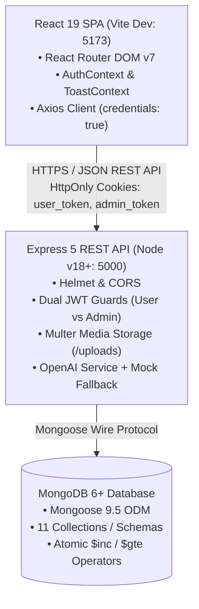
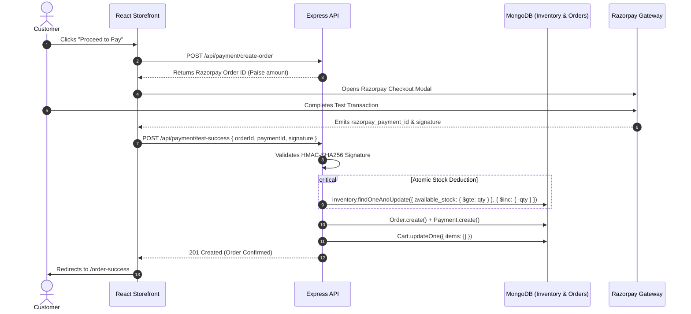
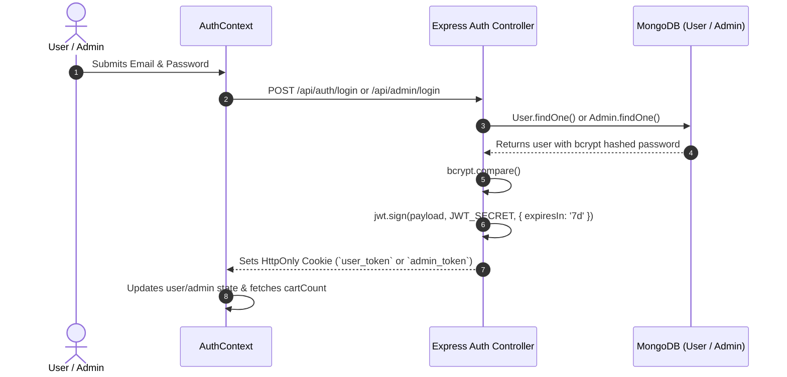

# ⚡ TechZone — AI-Powered Electronics E-Commerce Platform

[](https://react.dev/)
[](https://vitejs.dev/)
[](https://nodejs.org/)
[](https://expressjs.com/)
[](https://www.mongodb.com/)
[](https://razorpay.com/)
[](https://openai.com/)
[](#license)

A production-grade, enterprise-ready full-stack electronics e-commerce web platform engineered using **React 19**, **Node.js**, **Express 5**, and **MongoDB (Mongoose 9)**.

TechZone simulates a complete consumer electronics retail operation featuring contextual AI product advisory, atomic inventory synchronization, verified purchase reviews, dual-role Role-Based Access Control (RBAC), and Razorpay test payment processing.

---

## 📑 Table of Contents

- [Key Features](#-key-features)
  - [Customer Storefront](#1-customer-storefront)
  - [AI Shopping Assistant](#2-ai-shopping-assistant)
  - [Executive Admin Suite](#3-executive-admin-suite)
  - [Core Concurrency & Data Guarantees](#4-core-concurrency--data-guarantees)
- [System Architecture](#-system-architecture)
  - [MERN Decoupled Architecture](#mern-decoupled-architecture)
  - [Purchase & Inventory Deduction Flow](#purchase--inventory-deduction-flow)
  - [Dual-Role Authentication Lifecycle](#dual-role-authentication-lifecycle)
- [Technology Stack](#-technology-stack)
- [Project Directory Layout](#-project-directory-layout)
- [Prerequisites & System Requirements](#-prerequisites--system-requirements)
- [Environment Configuration](#-environment-configuration)
- [Step-by-Step Installation & Quickstart](#-step-by-step-installation--quickstart)
- [Database Seeding & Setup](#-database-seeding--setup)
- [Default Test Credentials](#-default-test-credentials)
- [Comprehensive REST API Reference](#-comprehensive-rest-api-reference)
- [Concurrency & Security Engineering](#-concurrency--security-engineering)
- [Available NPM Scripts](#-available-npm-scripts)
- [Production Roadmap](#-production-roadmap)
- [Contributing & License](#-contributing--license)

---

## 🚀 Key Features

### 1. Customer Storefront
- **Dynamic Electronics Catalog**: Search gadgets by keyword, filter across categories (*Mobiles*, *Laptops*, *Headphones*, *Smart Watches*, *Accessories*), and sort dynamically by price ascending/descending.
- **Detailed Specifications Sheet**: High-resolution image galleries, battery life, camera sensors, OS/connectivity details, and live inventory status badges (`In Stock`, `Low Stock`, `Out of Stock`).
- **Interactive Shopping Cart**: Real-time quantity updates bounded by server-side stock ceiling checks.
- **Tiered Checkout Calculation**: Automatic calculation of 18% GST and free shipping thresholds (Free for orders $\ge$ ₹1,000, otherwise ₹50).
- **Razorpay Test Payment Gateway**: Native checkout modal with HMAC-SHA256 signature verification.
- **Complete Order Lifecycle**: Tracking dashboard, printable receipt breakdowns, and instant order cancellation with automated inventory restoration.
- **Verified Purchase Ratings**: 5-star customer review system restricted strictly to buyers who have completed a paid purchase.
- **Personalization**: Saved wishlist bookmarks and recently viewed items carousel.

---

### 2. AI Shopping Assistant
- **Context-Aware Product Advisor**: Slide-in side drawer (`ProductAISheet`) on product detail pages. Injects hardware specs, processor chips, and battery details directly into OpenAI prompts to deliver factual technical advice and device comparisons.
- **Autonomous Store Chatbot**: Standalone conversational shopping advisor (`/ai-assistant`) that assists customers in choosing gadgets according to budget and use-case.
- **Deterministic Mock Engine**: Seamless fallback engine providing instantaneous, zero-latency answers if external OpenAI API keys are not supplied.

---

### 3. Executive Admin Suite
- **Analytics Dashboard**: Aggregated business metrics including Total Orders, Gross Revenue, Low Stock Alerts, and Recent Sales.
- **Product Catalog Management**: Multi-field CRUD interface with multi-image disk uploads via Multer and automated file deletion on record removal.
- **Category Hierarchy**: Category CRUD with cover image upload support.
- **Real-Time Inventory Control**: Direct table for monitoring `available_stock` vs `reserved_stock` with manual stock adjustment capabilities.
- **Fulfillment Pipeline**: Full lifecycle status management (`Pending` $\to$ `Processing` $\to$ `Shipped` $\to$ `Delivered` / `Cancelled`).
- **User Registry**: Centralized customer accounts directory and purchase history viewer.
- **Review Moderation**: Administrative oversight to inspect and delete inappropriate customer reviews.

---

### 4. Core Concurrency & Data Guarantees
- **Atomic Stock Deductions**: Uses MongoDB `$inc` and `$gte` atomic updates during order placement to eliminate race conditions and prevent overselling.
- **Automated Stock Restoration**: Restores item quantities back to available inventory immediately upon order cancellation.
- **Immutable Financial Snapshots**: `Order.items` permanently stores historical unit prices and subtotals, ensuring past invoices remain accurate regardless of future product price edits.

---

## 🏗️ System Architecture

### MERN Decoupled Architecture



---

### Purchase & Inventory Deduction Flow



---

### Dual-Role Authentication Lifecycle



---

## 🧰 Technology Stack

### Frontend Architecture
| Technology | Version | Purpose |
|---|---|---|
| **React** | `19.2.4` | Declarative component UI engine with modern hooks |
| **React DOM** | `19.2.4` | DOM rendering targets |
| **Vite** | `8.0.4` | Ultra-fast build tool and local development server |
| **React Router DOM** | `7.14.1` | Client-side routing, nested layouts, and route guards |
| **Axios** | `1.15.0` | HTTP client with automatic cookie handling and interceptors |
| **Lucide React** | `1.8.0` | Accessible, tree-shakeable SVG icon collection |
| **React Hook Form** | `7.72.1` | Performant form state management and input validation |

### Backend Architecture
| Technology | Version | Purpose |
|---|---|---|
| **Node.js** | `v18.0.0+` | Asynchronous JavaScript runtime (ES Modules) |
| **Express.js** | `5.2.1` | Minimalist web application and API routing framework |
| **Mongoose** | `9.5.0` | Strict schema validation and MongoDB ODM |
| **JSONWebToken** | `9.0.3` | HMAC-SHA256 stateless authorization tokens |
| **Bcrypt** | `6.0.0` | 10-round salted password cryptography |
| **Multer** | `2.1.1` | Multipart disk storage pipeline for media uploads |
| **Helmet** | `8.1.0` | HTTP response security headers |
| **CORS** | `2.8.6` | Whitelisted cross-origin request coordination |
| **Cookie-Parser**| `1.4.7` | Parses client cookies into `req.cookies` |
| **Razorpay** | `2.9.6` | Official payment gateway integration SDK |
| **OpenAI** | `6.34.0` | Client for GPT-powered contextual product advice |
| **Morgan** | `1.10.1` | HTTP request development logging middleware |

---

## 📁 Project Directory Layout

```
react_node_mongodb/
├── backend/                          # Express API & MongoDB Models
│   ├── config/
│   │   ├── db.js                     # Mongoose connection bootstrap
│   │   └── multer.js                 # Multer storage configuration
│   ├── controllers/                  # 17 Domain controllers
│   │   ├── adminAuthController.js    # Admin login, logout, session check
│   │   ├── adminCategoryController.js# Category management CRUD
│   │   ├── adminDashboardController.js# Analytics metrics aggregation
│   │   ├── adminOrderController.js   # Order pipeline & status updating
│   │   ├── adminProductController.js # Product CRUD with image uploads
│   │   ├── adminUserController.js    # User registry & order audit
│   │   ├── aiController.js           # OpenAI shopping & product endpoints
│   │   ├── cartController.js         # Cart operations & stock ceiling checks
│   │   ├── checkoutController.js     # Tax, shipping & total computation
│   │   ├── inventoryController.js    # Real-time stock queries & adjustments
│   │   ├── orderController.js        # User order tracking & cancellation
│   │   ├── paymentController.js      # Razorpay order generation & signature verify
│   │   ├── productController.js      # Public catalog, filters & specs
│   │   ├── recentlyViewedController.js# Browsing history tracking
│   │   ├── reviewController.js       # Verified review creation & moderation
│   │   ├── userAuthController.js     # User registration, login & profile update
│   │   └── wishlistController.js     # Saved products bookmarking
│   ├── middleware/
│   │   ├── authMiddleware.js         # verifyUserToken & verifyAdminToken guards
│   │   └── uploadMiddleware.js       # Disk storage for avatars & categories
│   ├── models/                       # 11 Mongoose Schemas & Models
│   │   ├── Admin.js, Cart.js, Category.js, Inventory.js, Order.js,
│   │   ├── Payment.js, Product.js, RecentlyViewed.js, Review.js,
│   │   └── User.js, Wishlist.js
│   ├── routes/                       # 12 Modular Express Route files
│   ├── scripts/
│   │   └── seedElectronicsData.js    # Automated electronics catalog seeder
│   ├── services/
│   │   └── aiService.js              # OpenAI prompt builder & mock fallback
│   ├── uploads/                      # Local storage directory for media assets
│   ├── app.js                        # Express middleware & route registration
│   ├── server.js                     # HTTP server listener entry point
│   ├── package.json
│   └── .env                          # Backend environment variables
│
├── frontend/                         # React 19 Client SPA
│   ├── public/                       # Static media, icons & logos
│   ├── src/
│   │   ├── components/
│   │   │   ├── AI/                   # ProductAISheet drawer
│   │   │   ├── Admin/                # AdminLayout, AdminSidebar
│   │   │   ├── Layout/               # Navbar, Footer, Main Layout
│   │   │   ├── Products/             # ProductCard, RecentlyViewed, StarRating
│   │   │   ├── Reviews/              # ReviewSection, StarRating
│   │   │   ├── UI/                   # ConfirmationModal, ReviewModal, Toast
│   │   │   └── ProtectedRoute.jsx    # Role-based route authorization guard
│   │   ├── context/
│   │   │   ├── AuthContext.jsx       # Global session & cart badge state
│   │   │   └── ToastContext.jsx      # Non-blocking toast alert provider
│   │   ├── pages/
│   │   │   ├── Admin/                # 8 Management views (Dashboard, Products...)
│   │   │   ├── AIAssistant/          # Standalone AI Store Advisor
│   │   │   ├── Auth/                 # Login, Register, Profile dashboards
│   │   │   ├── Cart/                 # Cart review & quantity modification
│   │   │   ├── Catalog/              # Search, filter, and sorting catalog
│   │   │   ├── Checkout/             # Shipping address & Razorpay payment
│   │   │   ├── Home/                 # Hero banners & featured gadgets
│   │   │   ├── NotFound/             # 404 Route handler
│   │   │   ├── ProductDetail/        # Image gallery, specs & AI sheet
│   │   │   └── Wishlist/             # Saved items list
│   │   ├── services/
│   │   │   └── api.js                # Central Axios client with credentials
│   │   ├── utils/
│   │   │   └── formUtils.js          # Numeric input scroll lock helper
│   │   ├── App.jsx                   # Central route configurations
│   │   ├── main.jsx                  # React DOM mount point
│   │   └── index.css                 # Global design tokens & utility styles
│   ├── vite.config.js
│   └── package.json
│
├── __skills__/                       # 23 Architecture Blueprints & Tech Standards
├── dryfruit_hub_db.admins.json       # Admin credentials export for reference
└── readme.md                         # Project documentation
```

---

## ⚙️ Prerequisites & System Requirements

Before running the application locally, ensure you have the following installed:

- **Node.js**: `v18.0.0` or higher ([Download Node.js](https://nodejs.org/))
- **NPM**: `v9.0.0` or higher (Bundled with Node.js)
- **MongoDB**: `v6.0.0` or higher running locally on port `27017` or a MongoDB Atlas connection URI ([Download MongoDB Community](https://www.mongodb.com/try/download/community))
- **Git**: Installed for version control

---

## 🔑 Environment Configuration

Create a `.env` file in the `backend/` directory:

```bash
# Path: backend/.env

# Database Configuration
MONGO_URI=mongodb://localhost:27017/dryfruit_hub_db

# Server Configuration
PORT=5000
NODE_ENV=development

# Authentication
JWT_SECRET=your_super_secret_jwt_key_here_123456789!@#

# Razorpay Test Mode Credentials
RAZORPAY_KEY_ID=rzp_test_dRWiKHS7zr2Gki
RAZORPAY_KEY_SECRET=your_razorpay_secret_here

# OpenAI API Configuration (Optional - Mock fallback activates if omitted)
OPENAI_API_KEY=sk-your-openai-api-key
```

Frontend Environment (Optional, `frontend/.env`):
```bash
# Path: frontend/.env
VITE_API_URL=http://localhost:5000/api
```

---

## 💻 Step-by-Step Installation & Quickstart

### 1. Clone the Repository
```bash
git clone https://github.com/1996-Subhrato/react-node-mongodb-electronic-store.git
cd react-node-mongodb-electronic-store
```

### 2. Configure & Run Backend API
```bash
# Navigate to backend
cd backend

# Install dependencies
npm install

# Verify your .env file is present
# Start backend in development mode with Nodemon
npm run dev
```
*The backend API server will start on `http://localhost:5000` with MongoDB connected.*

### 3. Seed Database with Electronics Merchandise
In a separate terminal window, populate initial categories and electronics products:
```bash
cd backend
node scripts/seedElectronicsData.js
```
*This inserts categories (Mobiles, Laptops, Headphones, Smart Watches, Accessories), flagship devices (iPhone 15 Pro, Galaxy S23 Ultra, MacBook Air M2, Sony XM5), and synchronizes inventory records.*

### 4. Configure & Run Frontend Client
```bash
# Open a new terminal and navigate to frontend
cd frontend

# Install dependencies
npm install

# Launch Vite development server
npm run dev
```
*The React storefront will open automatically at `http://localhost:5173`.*

---

## 👤 Default Test Credentials

| Role | Portal URL | Email Address | Password |
|---|---|---|---|
| **Administrator** | `http://localhost:5173/admin/login` | `admin@gmail.com` | `admin123` *(or register via DB)* |
| **Customer** | `http://localhost:5173/login` | *Create any account via Register* | User chosen |

> **Tip**: You can register a new customer account instantly on `http://localhost:5173/register` to test the shopping cart, AI advisor, reviews, and Razorpay test payment flows.

---

## 📡 Comprehensive REST API Reference

### Customer Authentication (`/api/auth`)
| Verb | URI | Access | Description |
|---|---|---|---|
| `POST` | `/api/auth/register` | Public | Register new customer account |
| `POST` | `/api/auth/login` | Public | Login customer and issue `user_token` cookie |
| `POST` | `/api/auth/logout` | Public | Invalidate customer cookie |
| `GET` | `/api/auth/profile` | Customer | Fetch current customer profile |
| `PUT` | `/api/auth/profile` | Customer | Update name, phone, or avatar image |
| `PUT` | `/api/auth/change-password` | Customer | Verify current password and update to new |
| `GET` | `/api/auth/session` | Public | Non-throwing session check for React initial boot |

### Storefront Catalog (`/api/products`)
| Verb | URI | Access | Description |
|---|---|---|---|
| `GET` | `/api/products` | Public | Search (`?search=`), filter (`?category=`), sort (`?sort=`) |
| `GET` | `/api/products/categories` | Public | Fetch list of active categories |
| `GET` | `/api/products/:id` | Public | Fetch product specifications and image gallery |
| `GET` | `/api/products/:id/related` | Public | Fetch recommended items from same category |

### Cart & Checkout (`/api/cart`, `/api/checkout`)
| Verb | URI | Access | Description |
|---|---|---|---|
| `GET` | `/api/cart` | Customer | Fetch current customer cart with line totals |
| `POST` | `/api/cart/add` | Customer | Add product to cart with stock validation |
| `PUT` | `/api/cart/item/:id` | Customer | Update item quantity within available stock limits |
| `DELETE`| `/api/cart/item/:id` | Customer | Remove line item from cart |
| `GET` | `/api/checkout/summary` | Customer | Compute subtotal, 18% GST, and shipping charge |

### Payments & Orders (`/api/payment`, `/api/orders`)
| Verb | URI | Access | Description |
|---|---|---|---|
| `POST` | `/api/payment/create-order` | Customer | Generate Razorpay order ID in paise |
| `POST` | `/api/payment/test-success` | Customer | Verify HMAC signature, deduct stock, create order |
| `GET` | `/api/orders/my-orders` | Customer | Retrieve customer order history |
| `GET` | `/api/orders/:id` | Customer | Retrieve full order receipt with review status |
| `POST` | `/api/orders/:id/cancel` | Customer | Cancel pending order and restore stock |

### AI Shopping Assistants (`/api/ai`)
| Verb | URI | Access | Description |
|---|---|---|---|
| `POST` | `/api/ai/ask-general` | Public | Autonomous store chatbot recommendations |
| `POST` | `/api/ai/ask-product` | Customer | Context-aware Q&A on specific hardware specs |

### Reviews & Wishlist (`/api/reviews`, `/api/wishlist`)
| Verb | URI | Access | Description |
|---|---|---|---|
| `GET` | `/api/reviews/:productId` | Public | Retrieve public reviews for an item |
| `GET` | `/api/reviews/check/:productId` | Customer | Check if user completed a paid purchase |
| `POST` | `/api/reviews` | Customer | Submit verified customer review & star rating |
| `DELETE`| `/api/reviews/:id` | Admin | Administrative review moderation |
| `GET` | `/api/wishlist` | Customer | Fetch saved wishlist items |
| `POST` | `/api/wishlist/add` | Customer | Bookmark item to wishlist |
| `DELETE`| `/api/wishlist/:id` | Customer | Remove item from wishlist |

### Admin Management Suite (`/api/admin`)
| Verb | URI | Access | Description |
|---|---|---|---|
| `POST` | `/api/admin/login` | Public | Authenticate administrator (`admin_token`) |
| `GET` | `/api/admin/stats` | Admin | Aggregate revenue, total orders, and low-stock count |
| `GET` | `/api/admin/products` | Admin | Retrieve product table with stock counts |
| `POST` | `/api/admin/products` | Admin | Create product with primary and gallery uploads |
| `PUT` | `/api/admin/products/:id` | Admin | Update product specifications and media |
| `DELETE`| `/api/admin/products/:id` | Admin | Delete product and unlink media from disk |
| `GET` | `/api/admin/orders` | Admin | Retrieve all platform customer orders |
| `PUT` | `/api/admin/orders/:id/status`| Admin | Progress order status (`Processing`, `Shipped`...) |
| `GET` | `/api/admin/inventory` | Admin | Live available and reserved stock overview |
| `PUT` | `/api/admin/inventory/:productId` | Admin | Manual stock level adjustment |
| `GET` | `/api/admin/users` | Admin | View customer accounts and order histories |

---

## 🔒 Concurrency & Security Engineering

1. **Race-Condition Free Stock Management**:
   ```javascript
   // Atomic decrement during order placement
   const inventory = await Inventory.findOneAndUpdate(
       { product: item.product, available_stock: { $gte: item.quantity } },
       { $inc: { available_stock: -item.quantity } },
       { new: true }
   );
   if (!inventory) throw new Error("Insufficient stock.");
   ```
2. **HttpOnly Cookie Protection**: Auth tokens cannot be accessed via `document.cookie` or injected browser scripts, blocking Cross-Site Scripting (XSS) token theft.
3. **Cross-Site Request Forgery (CSRF) Mitigation**: Cookies are configured with `SameSite: Lax` and restricted strictly to authorized origins.
4. **Parameter Tampering Prevention**: The client never calculates order totals; subtotals, GST, and shipping charges are recomputed on the server inside `paymentController.js` before transaction confirmation.
5. **HMAC-SHA256 Signature Verification**: Payment payloads are validated cryptographically against `RAZORPAY_KEY_SECRET` before stock deduction or order creation.

---

## 📜 Available NPM Scripts

### Backend (`backend/package.json`)
```bash
npm run dev     # Start backend with Nodemon hot-reloading
npm start       # Start backend in standard Node production mode
node scripts/seedElectronicsData.js # Seed MongoDB with modern electronics catalog
```

### Frontend (`frontend/package.json`)
```bash
npm run dev     # Start Vite development server (localhost:5173)
npm run build   # Compile optimized production bundle to frontend/dist/
npm run preview # Preview production build locally
npm run lint    # Run ESLint validation across all components and pages
```

---

## 🚀 Production Roadmap

- [ ] **Cloudinary / AWS S3 Media Storage**: Replace local disk storage with cloud CDN streaming for scalable container deployments.
- [ ] **Live Razorpay Webhooks**: Implement `/api/payment/webhook` to handle asynchronous payment captures and drop-offs.
- [ ] **Transactional Email Notifications**: Integrate Nodemailer / SendGrid for automated order confirmation and tracking emails.
- [ ] **WebSockets (Socket.io)**: Enable real-time order status updates for customers and live inventory alerts for administrators.
- [ ] **Redis Caching**: Cache `GET /api/products` and high-frequency category queries with automated cache invalidation upon admin edits.

---

## 📄 License & Attribution

This project is licensed under the **ISC License**. Developed as an enterprise-grade reference architecture for modern full-stack web applications.